# Mini Trading App

Live US stock prices, interactive history charts across six ranges, catalogue search and a starred watchlist across web (Next.js App Router) and mobile (Expo Go), sharing one platform-agnostic client core and one Node/Fastify market-data gateway. The gateway runs a deterministic fixed-point simulator by default and an opt-in Alpaca live feed when configured; simulated and live feeds are never mixed, and incompatible feed changes quarantine the client session. It starts locally with one command and no API keys.

> **Hosted simulator demo:** [stocks-watchlist-puce.vercel.app](https://stocks-watchlist-puce.vercel.app/) backed by the [Fly.io simulator gateway](https://hisham-stocks-gateway.fly.dev/health). Prices are simulated, not live market data. The public gateway runs with `CHAOS_SCOPE=connection`, so `/?debug=1` exposes only connection-local controls (`drop` and `freeze`); run locally for shared simulator controls ([ADR 0072](docs/adr/0072-chaos-scope-keeps-shared-controls-off-public-gateways.md)).

|            | Light                                                        | Dark                                                       |
| ---------- | ------------------------------------------------------------ | ---------------------------------------------------------- |
| Web list   | 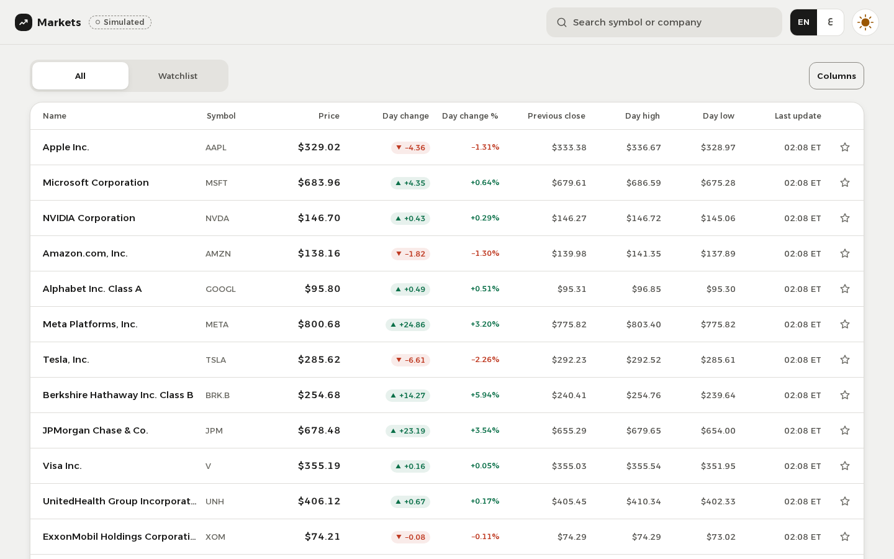        | 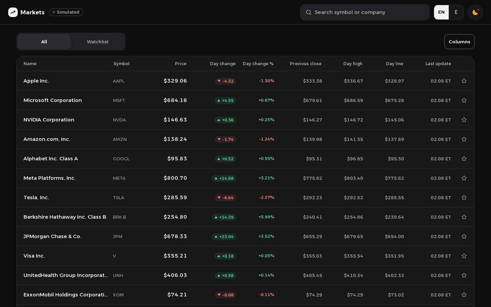        |
| Web detail | 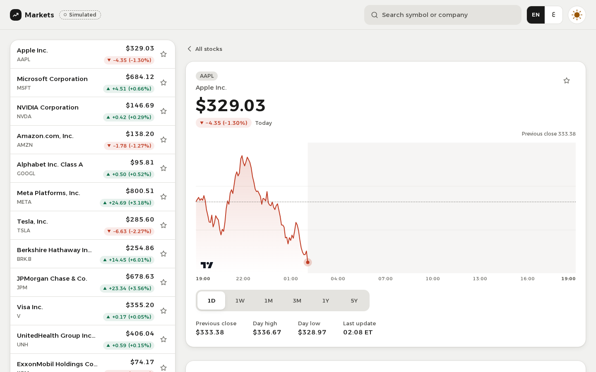 | 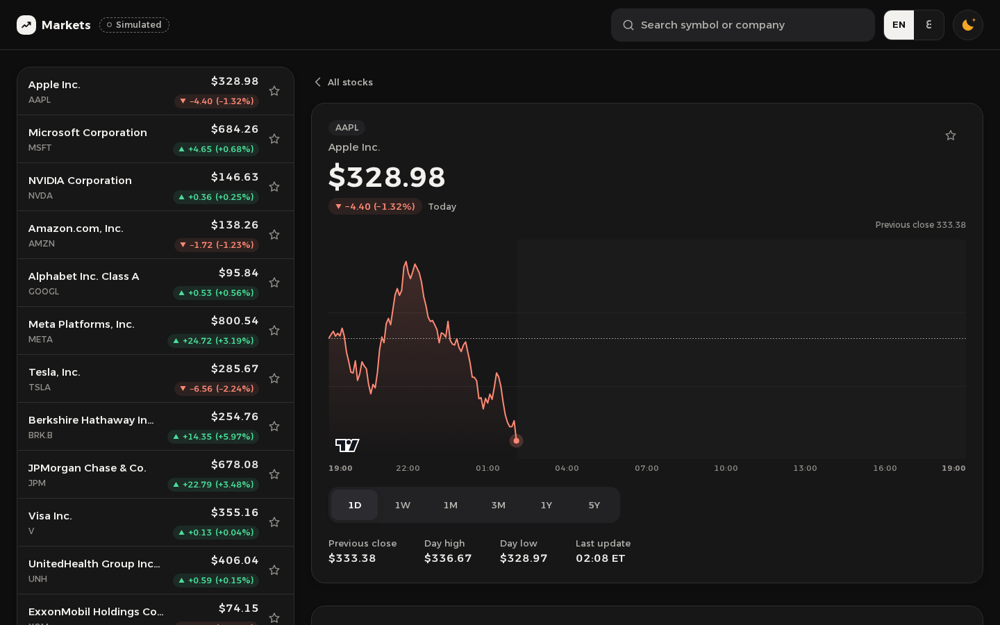 |

Mobile captures from Expo Go on an iPhone 17 simulator (visual captures only; see [Verification](#verification-and-measured-results) for mobile runtime status):

|       | Markets                                                                             | AAPL detail                                                                               | Settings                                                                                 |
| ----- | ----------------------------------------------------------------------------------- | ----------------------------------------------------------------------------------------- | ---------------------------------------------------------------------------------------- |
| Light | 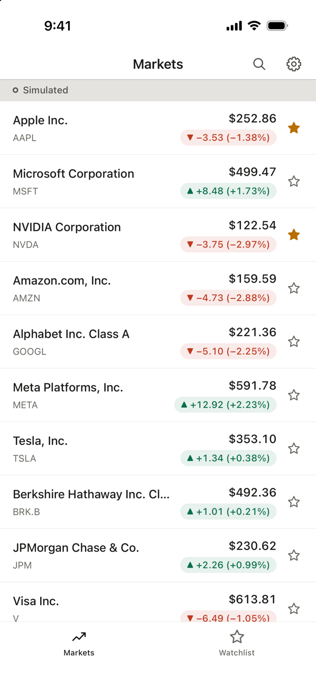 | 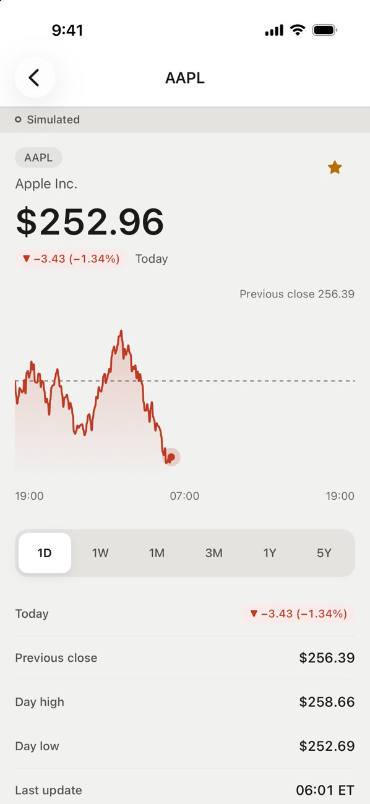 | 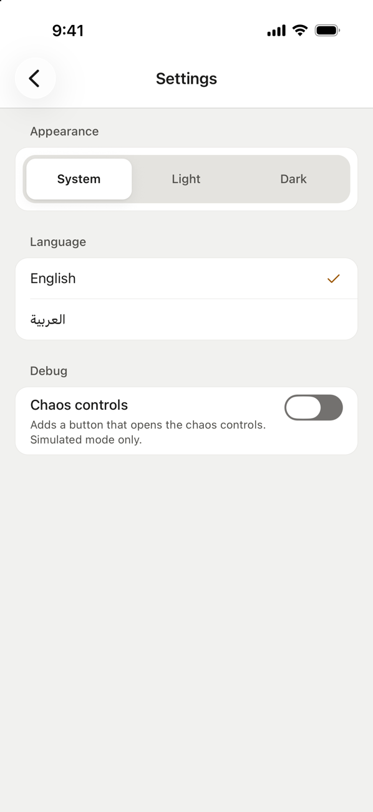 |
| Dark  | 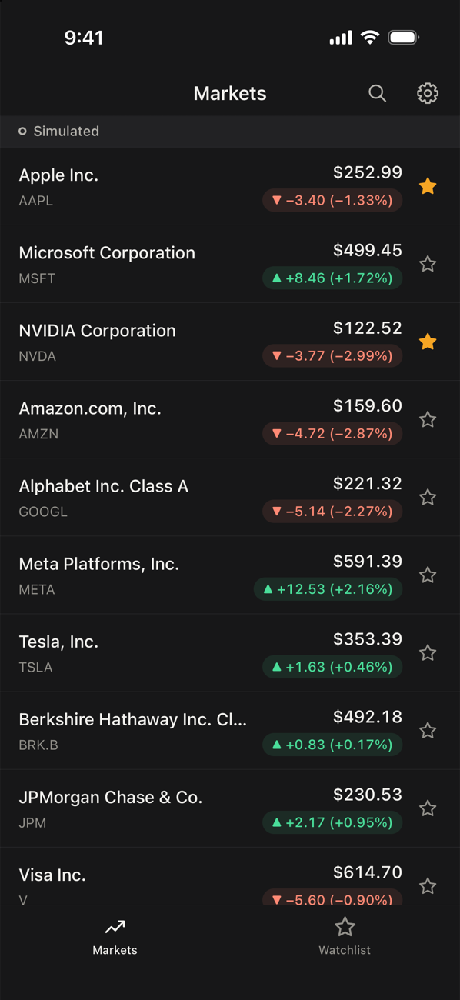   | 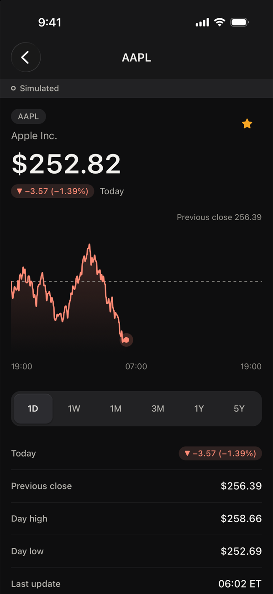   | 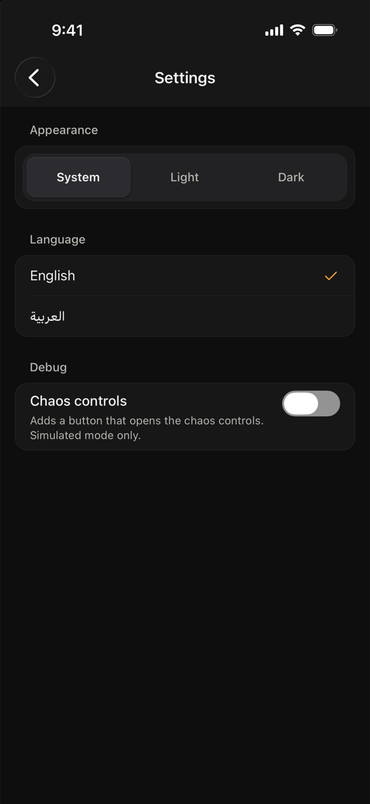   |

## Two-minute tour

1. **Live list & controls:** Open the hosted demo (or `http://localhost:3000`). Fifty stocks tick over one WebSocket; scroll past row 50 to page through the ~500-symbol simulator catalogue, switch light/dark or Arabic RTL without dropping the socket, and customise desktop columns.
2. **Stock detail:** Open `AAPL` to switch `1D`–`5Y` ranges, scrub in Eastern Time (`ET`), and view day range plus independent overview, statistics, news and earnings sections (simulator omits price-dependent P/E and 52-week range rather than contradicting simulated quotes, [ADR 0080](docs/adr/0080-omit-unsupported-simulated-year-range.md)).
3. **Search & watchlist:** Search by ticker or name (`GET /stocks/search?q=`), star stocks from rows, search or detail, and verify persistence, rollback on write errors and cross-tab sync in Watchlist.
4. **Chaos & health:** Append `?debug=1` on web (or enable Debug in mobile Settings) to drop/freeze the socket locally or on the hosted demo; locally (`CHAOS_SCOPE=global`), also spike ticks under the 4/s conflation cap, simulate failing history ("As of" fallback), or force **Market closed** (auto-reverts after 60 s). Open `/health` on the gateway for active connections, watchers, cache hit rate and built `revision`.

## Quick start (no keys)

Requires **Node 26** and **pnpm 10** (`npm install -g pnpm@10`; Node 26 omits Corepack, [ADR 0032](docs/adr/0032-pinned-toolchain-and-one-command-start.md)).

```bash
pnpm i
pnpm dev
```

Starts the simulator gateway at `http://localhost:4000` (always-open UTC session) and web app at `http://localhost:3000`. See [`docs/running.md`](docs/running.md) for custom ports, Expo Go on a phone/emulator, Alpaca Live mode (`FEED=alpaca`), Playwright E2E and full check commands, and [`docs/deploy.md`](docs/deploy.md) for Fly.io and Vercel deployment steps.

## Scope

As set out in [`docs/spec.md`](docs/spec.md):

- **Built first:** Fastify gateway (deterministic simulator, ref-counted hub, 250 ms conflation, REST, LRU/SWR history cache with closed-market finalization [#124](https://github.com/hishamank/market-watcher/commit/dcc2f5d)); Zod contracts and BigInt money math; shared core; Next.js web app (virtualised list, 6-range scrubbing chart with native range buttons [#119](https://github.com/hishamank/market-watcher/commit/483ca39) and row metric labels [#122](https://github.com/hishamank/market-watcher/commit/3088bd8), on-device watchlist with cross-tab sync, corrupt-storage recovery and write rollback [#118](https://github.com/hishamank/market-watcher/commit/8b44add), loading/stale/offline/error states, SEO [#87](https://github.com/hishamank/market-watcher/commit/d4b77ef), nonce CSP and security headers [#135](https://github.com/hishamank/market-watcher/commit/33447a1), RTL/i18n/a11y); scoped chaos controls; unit/E2E tests; committed AI workflow.
- **Architectural & hardening:** Visibility-driven subscriptions, 64 KB/10 s backpressure, subscribe `requestId` ([#31](https://github.com/hishamank/market-watcher/commit/d80b8d6)), always-applied unsubscribes ([#91](https://github.com/hishamank/market-watcher/commit/77a6e67)), feed-session quarantine ([#120](https://github.com/hishamank/market-watcher/commit/2960857)), per-symbol availability and metadata ordering ([#113](https://github.com/hishamank/market-watcher/commit/09de3e2)/[#134](https://github.com/hishamank/market-watcher/commit/b0f97f9)), SSR read deduplication and `WeakMap` fallback index ([#89](https://github.com/hishamank/market-watcher/commit/901d888)/[#117](https://github.com/hishamank/market-watcher/commit/722c1d1)), public `CHAOS_SCOPE=connection` ([#114](https://github.com/hishamank/market-watcher/commit/a8e6f35)/[#123](https://github.com/hishamank/market-watcher/commit/0d05335)), `SIGTERM` drain & `/health` revision ([#115](https://github.com/hishamank/market-watcher/commit/daded17)), two-stage digest-pinned image ([#129](https://github.com/hishamank/market-watcher/commit/5d47fe9)), socket work bounds & 2,000-socket / IPv6 `/64` caps ([#126](https://github.com/hishamank/market-watcher/commit/e803371)/[#130](https://github.com/hishamank/market-watcher/commit/464adba)), startup config validation & redacted logs ([#127](https://github.com/hishamank/market-watcher/commit/06f4469)), debug health metrics & subscription/symbol recovery diagnostics ([#48](https://github.com/hishamank/market-watcher/commit/32169dc)/[#131](https://github.com/hishamank/market-watcher/commit/1cc9a77)).
- **Built next:** Expo Go app (Markets/Watchlist tabs, detail scrubbing, lifecycle [#44](https://github.com/hishamank/market-watcher/commit/01fadec)/[#56](https://github.com/hishamank/market-watcher/commit/f790cea)/[#60](https://github.com/hishamank/market-watcher/commit/8df3623)/[#63](https://github.com/hishamank/market-watcher/commit/7375ab9), Settings theme/language, status strip & market status, scoped chaos [#99](https://github.com/hishamank/market-watcher/commit/2df6ae8)/[#101](https://github.com/hishamank/market-watcher/commit/892efc0)/[#123](https://github.com/hishamank/market-watcher/commit/0d05335), search [#100](https://github.com/hishamank/market-watcher/commit/562fc27), large-text fixes [#109](https://github.com/hishamank/market-watcher/commit/4c6463a)); Alpaca live feed (30-stream + polled rest under 180/60 req/min budget [#47](https://github.com/hishamank/market-watcher/commit/7633576)/[#132](https://github.com/hishamank/market-watcher/commit/b3da74d), phase enforcement & `lastKnown` [#59](https://github.com/hishamank/market-watcher/commit/a9f1339)/#61); web search ([#46](https://github.com/hishamank/market-watcher/commit/03144fe)), paging ([#74](https://github.com/hishamank/market-watcher/commit/70d75f7)), Arabic RTL ([#75](https://github.com/hishamank/market-watcher/commit/a72b6ed)/[#84](https://github.com/hishamank/market-watcher/commit/cc4212a)), web-owned columns ([#77](https://github.com/hishamank/market-watcher/commit/44bcef4)/[#136](https://github.com/hishamank/market-watcher/commit/27d1978)), supplemental company data ([#78](https://github.com/hishamank/market-watcher/commit/6d65510)/[#128](https://github.com/hishamank/market-watcher/commit/85a8bca)), hosted demo.
- **Not built:** Server-side watchlist (`N07`, #22), trading/portfolios, extended-hours quotes, candlesticks/indicators, Yahoo prices/search, accounts/push, tick replay, custom native builds, and Redis/multi-node clustering.

## How it was built with AI

The engineering workflow is committed alongside the code: shared rules ([`CLAUDE.md`](CLAUDE.md)), team guide ([`docs/ai/README.md`](docs/ai/README.md)), skill provenance ([`docs/ai/SOURCES.md`](docs/ai/SOURCES.md)), and bundled skills in `.claude/skills/` (`grill-with-docs`, `code-review`, `pr`, [`verify`](.claude/skills/verify/SKILL.md)).

- **Human-led process:** An interactive design-grilling session with the owner produced the initial ADRs, glossary, spec, feature map and roadmap before coding began. Scoped GitHub issues ran in isolated worktrees (`t/<issue>-<slug>`) across parallel lanes, choosing models per assignment ([ADR 0067](docs/adr/0067-model-selection-per-assignment.md)). Feature PRs were reviewed in fresh contexts across model families, followed by a security, architecture and QA hardening pass (`#112`–`#136`); [`docs/ai/README.md`](docs/ai/README.md) records the workflow with examples. The owner directed merges and priorities.
- **Traceable technical outcomes:**
  - _Deterministic simulator:_ Fixed-point BigInt Brownian-bridge pricing keeps ticks and history consistent ([`price.ts`](apps/gateway/src/feeds/simulator/price.ts), [ADR 0022](docs/adr/0022-deterministic-simulator-with-pluggable-market-calendar.md)).
  - _Protocol & reliability hardening:_ Cross-family review drove correlated subscribe request IDs ([#27](https://github.com/hishamank/market-watcher/commit/0086907)/[#28](https://github.com/hishamank/market-watcher/commit/c2fc82a)/[#31](https://github.com/hishamank/market-watcher/commit/d80b8d6), [ADR 0038](docs/adr/0038-subscribe-replies-carry-a-request-id.md)), always-applied unsubscribes ([#91](https://github.com/hishamank/market-watcher/commit/77a6e67)), feed-session quarantine ([#120](https://github.com/hishamank/market-watcher/commit/2960857)), closed-market history finalization ([#124](https://github.com/hishamank/market-watcher/commit/dcc2f5d)), and per-symbol quote availability ([#113](https://github.com/hishamank/market-watcher/commit/09de3e2)/[#134](https://github.com/hishamank/market-watcher/commit/b0f97f9)).
  - _Measured optimization & audits:_ Cold-cache quote fallback indexing verified via A/B benchmark ([#89](https://github.com/hishamank/market-watcher/commit/901d888), [`docs/performance/quote-cache-index.md`](docs/performance/quote-cache-index.md)) and tautological-test cleanup ([#104](https://github.com/hishamank/market-watcher/commit/a810358)). Additional cross-family review catches (`#38`, `#43`, `#47`, `#61`) are recorded in [`docs/ai/README.md`](docs/ai/README.md#what-cross-family-review-caught).
- **Guardrails & limits:** OxLint enforces zero comments, 80-line app functions, 200-line files and the `useEffect` fence (`pnpm lint:fixtures`). Claude-specific deny entries in [`.claude/settings.json`](.claude/settings.json) supplement `CLAUDE.md` guardrails; they are **not** a cross-provider security boundary ([`docs/ai/README.md`](docs/ai/README.md#what-is-enforced-and-what-is-asked)).
- **Friction encountered:** GitHub Actions was blocked by account billing limits throughout development (gates ran locally); parallel E2E port collisions drove `E2E_*_PORT` overrides ([#54](https://github.com/hishamank/market-watcher/commit/64a3a64)); `react-native-graph` failed on Expo Go SDK 58 Skia, triggering the `react-native-wagmi-charts` fallback ([ADR 0033](docs/adr/0033-expo-go-constraint-and-react-native-graph.md)).

## Architecture overview

| Workspace                                  | Role                                                                                                                                            |
| ------------------------------------------ | ----------------------------------------------------------------------------------------------------------------------------------------------- |
| [`apps/gateway`](apps/gateway)             | Fastify REST + `/ws?v=1`, reference-counted hub, 250 ms conflation, bounded socket/admission limits, history cache, simulator & Alpaca adapters |
| [`apps/web`](apps/web)                     | Next.js App Router views, connected hooks, web-owned table columns (`apps/web/src/columns`), SSR prefetch, nonce CSP & Lightweight Charts       |
| [`apps/mobile`](apps/mobile)               | Expo Router / Expo Go views and native adapters sharing `packages/core`                                                                         |
| [`packages/contracts`](packages/contracts) | Sole source of Zod wire schemas, inferred types and BigInt money math                                                                           |
| [`packages/core`](packages/core)           | Shared platform-agnostic socket client, feed-session guard, keyed quote & availability stores, TanStack Query layer, hooks, i18n                |
| [`packages/analytics`](packages/analytics) | Product event catalogue, `useTrack`, and the console adapter that a provider such as PostHog can replace                                        |
| [`packages/tokens`](packages/tokens)       | Shared Graphite light/dark colours, spacing, typography, radii and motion tokens                                                                |

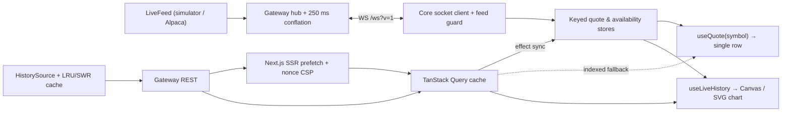

Full REST/WS endpoint tables, the subscribe-and-reply sequence diagram, supplemental stock-page sources and extended decision rationale live in [`docs/architecture.md`](docs/architecture.md). The multi-node 100,000-user scaling design—explicitly separated from local single-node ceilings and measurements—lives in [`docs/scaling.md`](docs/scaling.md).

## Code reading guide

1. **Deterministic pricing:** [`apps/gateway/src/feeds/simulator/price.ts`](apps/gateway/src/feeds/simulator/price.ts) — pure BigInt Brownian-bridge function aligning ticks and bars.
2. **Money math & wire contracts:** [`packages/contracts/src/money/money.ts`](packages/contracts/src/money/money.ts) — `1/10,000` BigInt arithmetic behind Zod wire schemas (`packages/contracts/src/quote.ts`).
3. **Gateway hub & admission:** [`apps/gateway/src/hub/hub.ts`](apps/gateway/src/hub/hub.ts) and [`admission.ts`](apps/gateway/src/socket/admission.ts) — ref-counted watchers, 250 ms conflation, backpressure and 2,000-socket / IPv6 `/64` caps.
4. **Client protocol & quarantine:** [`packages/core/src/realtime/socket-client.ts`](packages/core/src/realtime/socket-client.ts) — `requestId` settlement, feed-session quarantine, heartbeats and backoff.
5. **Quote store & fallback index:** [`packages/core/src/realtime/quote-store.ts`](packages/core/src/realtime/quote-store.ts) and [`quote-cache-sync.ts`](packages/core/src/rest/quote-cache-sync.ts) — per-symbol listeners, local metadata precedence and `WeakMap` hydration lookup.
6. **Shared API & chart boundary:** [`packages/core/src/index.ts`](packages/core/src/index.ts) — pinned core surface consumed by canvas web (`apps/web/src/integrations/chart/use-price-chart.ts`) and Expo Go (`apps/mobile/src/integrations/line-chart.tsx`).
7. **Key regression tests:** [`replies.test.ts`](apps/gateway/src/socket/replies.test.ts) and [`history-finalization.test.ts`](apps/gateway/src/rest/history-finalization.test.ts) — `requestId` settlement and closed-market history finalization.

## Key technical decisions and trade-offs

| Decision                                   | Rationale and trade-off                                                                                                                                                                 | ADR                                                                                                                                                                                                                                                                                                               |
| ------------------------------------------ | --------------------------------------------------------------------------------------------------------------------------------------------------------------------------------------- | ----------------------------------------------------------------------------------------------------------------------------------------------------------------------------------------------------------------------------------------------------------------------------------------------------------------- |
| Reference-counted gateway & explicit caps  | Upstream cost tracks distinct symbols and keys stay server-side; caps total sockets at 2,000, keys limits by IPv4/IPv6 `/64`, bounds pending ops/abuse and drains cleanly on `SIGTERM`. | [0006](docs/adr/0006-subscription-semantics-and-reference-counting.md), [0075](docs/adr/0075-gateway-closes-on-signals-and-reports-its-revision.md), [0076](docs/adr/0076-bound-socket-control-work-and-close-abusive-connections.md), [0092](docs/adr/0092-a-total-connection-cap-and-ipv6-budgets-by-prefix.md) |
| 250 ms conflation & backpressure           | Periodic quote batches cap at 4/s; slow sockets >64 KB skip and >10 s stuck close so clients see latest prices, never stale backlogs.                                                   | [0008](docs/adr/0008-per-connection-conflation-in-the-gateway.md)                                                                                                                                                                                                                                                 |
| Pre-rounded decimals + BigInt              | Avoids IEEE-754 float drift (notably Hermes on mobile); displayed change always equals displayed price − close.                                                                         | [0015](docs/adr/0015-server-owns-money-maths-wire-carries-rounded-decimal-strings.md), [0037](docs/adr/0037-rounding-display-precision-and-baseline-policy.md)                                                                                                                                                    |
| Explicit `FEED` mode & session quarantine  | Missing Alpaca keys fail fast; incompatible feed modes across reconnect/REST/hydration quarantine the `CoreProvider` until reload/restart.                                              | [0003](docs/adr/0003-split-live-feed-and-history-source.md), [0004](docs/adr/0004-explicit-feed-mode-and-gateway-owned-market-status.md), [0077](docs/adr/0077-feed-changes-require-a-new-client-session.md)                                                                                                      |
| Correlated `requestId` & metadata ordering | Eliminates subscribe ordering races, applies valid unsubscribes, prevents delayed REST from clearing `lastKnown`, and tracks per-symbol availability.                                   | [0038](docs/adr/0038-subscribe-replies-carry-a-request-id.md), [0066](docs/adr/0066-always-apply-valid-unsubscribes.md), [0083](docs/adr/0083-order-quote-metadata-and-track-symbol-availability.md)                                                                                                              |
| Keyed store, SSR dedup & nonce CSP         | Isolates tick re-renders per row, shares one SSR catalogue read, indexes hydration fallback, and enforces nonce-based web CSP.                                                          | [0012](docs/adr/0012-tanstack-query-for-requests-keyed-store-for-quotes.md), [0068](docs/adr/0068-index-the-hydration-quote-fallback.md), [0078](docs/adr/0078-share-initial-server-catalogue-reads.md), [0094](docs/adr/0094-web-security-headers-and-a-nonce-based-content-security-policy.md)                  |
| Shared core vs app presentation            | Core holds shared financial/connection/query policy (`index.test.ts`); web-only desktop column preferences live in `apps/web/src/columns`.                                              | [0002](docs/adr/0002-logic-free-components-and-platform-agnostic-core.md), [0041](docs/adr/0041-the-frozen-core-api.md), [0095](docs/adr/0095-web-owns-table-column-choices.md)                                                                                                                                   |
| Alpaca 30-stream + 180/60 shared budget    | Fits free-tier limits via one 180 req/min budget (60/min history sub-cap), hub-enforced phases and post-close history finalization.                                                     | [0021](docs/adr/0021-alpaca-adapter-streams-30-and-polls-the-rest.md), [0044](docs/adr/0044-hub-enforces-quote-phase-from-timestamps.md), [0082](docs/adr/0082-finalize-history-after-market-close.md), [0093](docs/adr/0093-history-gets-a-share-of-the-alpaca-budget.md)                                        |

Extended decision summaries live in [`docs/architecture.md`](docs/architecture.md#decisions-and-trade-offs-reference) and all 91 ADRs are indexed in [`docs/adrs.md`](docs/adrs.md).

## Verification and measured results

- **Post-merge reconciled `main` (`1cc9a77` + PR `#121`):** **644 passing unit/integration tests across 132 files** (fresh uncached run), plus `format:check`, `lint`, `lint:fixtures`, `check:direction`, `check:adrs` (86 unique ADRs), `typecheck`, and all local Markdown link/anchor/image checks passed.
- **An earlier full-check run on `a4a1b7a`:** 557 passing unit/integration tests across 110 files; 101 passing production Chromium E2E tests (0 retries); Chromium/Firefox/WebKit smoke; controlled render-isolation confirmation (zero unrelated row or list-parent commits); local simulator WS load test up to 1,000 loopback connections (50 shared symbols, logger off, 17.03 s including ramp-up: 0 errors, ~3,755 frames/s, 256 ms p99 quote age, cleanup to 0); no confirmed leaked credentials in scanned history.

**Caveats:** Baseline `a4a1b7a` E2E/load results are not automatically proof of later commits until rerun. Local single-node simulator benchmarks (loopback, shared dev host, no TLS) do **not** prove production or 100k capacity. Real Alpaca/Yahoo live feeds were not verified in those audits, GitHub Actions remained billing-blocked (checks ran locally), and native mobile screenshots are visual captures rather than full interactive audit proof. Full details and all 9 caveats: [`docs/verification.md`](docs/verification.md).

## Known limitations and out of scope

- **Same-mode dataset switches:** The wire protocol identifies `Simulated` vs `Live`, not simulator seeds or same-mode provider revisions ([ADR 0077](docs/adr/0077-feed-changes-require-a-new-client-session.md)).
- **Live session-boundary edge cases & unmeasured Alpaca defaults:** Post-restart symbols without a held quote return `unavailable`/`503`; empty healthy-boundary refreshes can return `503` for up to 5 s; Alpaca batch snapshot credit cost and 100-symbol batch default (`ADR 0021`) require a keyed run to confirm.
- **Operational scope:** Single-node in-memory gateway capped at 2,000 sockets (no Redis/multi-node clustering), GitHub Actions billing block (local verification only), approximate debug tick latency ([ADR 0036](docs/adr/0036-connection-health-metrics-in-the-debug-panel.md)), and default 120 req/min per-IPv4/IPv6 `/64` REST limit.
- **Out of scope:** Server-side watchlist (#22) and [`docs/spec.md#out-of-scope`](docs/spec.md#out-of-scope).

## Deeper documentation

- [`docs/running.md`](docs/running.md) · [`docs/deploy.md`](docs/deploy.md) · [`docs/architecture.md`](docs/architecture.md) · [`docs/scaling.md`](docs/scaling.md) · [`docs/verification.md`](docs/verification.md) · [`docs/adrs.md`](docs/adrs.md)
- [`docs/spec.md`](docs/spec.md) · [`docs/glossary.md`](docs/glossary.md) · [`docs/feature-map.md`](docs/feature-map.md) · [`docs/DESIGN.md`](docs/DESIGN.md) · [`docs/roadmap.md`](docs/roadmap.md)
- [`docs/ai/README.md`](docs/ai/README.md) · [`docs/ai/SOURCES.md`](docs/ai/SOURCES.md) · [`docs/performance/quote-cache-index.md`](docs/performance/quote-cache-index.md)

## TradingView notice

The web chart uses [TradingView Lightweight Charts](https://www.tradingview.com/lightweight-charts/) (Apache License 2.0) with its attribution logo enabled. Verbatim [`NOTICE`](https://github.com/tradingview/lightweight-charts/blob/v5.3.0/NOTICE):

```text
TradingView Lightweight Charts™
Copyright (с) 2025 TradingView, Inc. https://www.tradingview.com/
```
