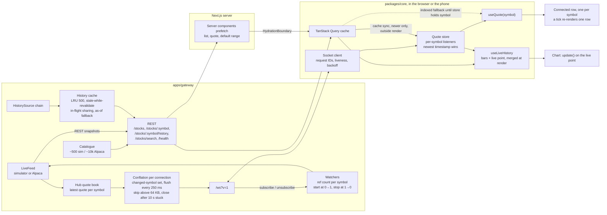
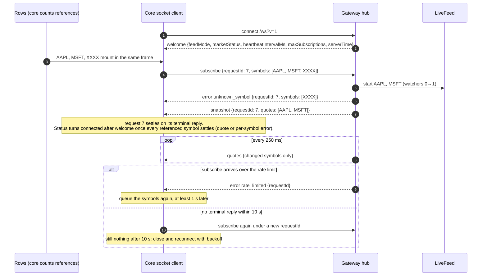

# Architecture and design reference

This document expands on the overview in [`README.md`](../README.md). Terms follow [`docs/glossary.md`](glossary.md), functional scope is in [`docs/spec.md`](spec.md), and individual decisions live in [`docs/adr/`](adr/) (indexed in [`docs/adrs.md`](adrs.md)).

## Workspace boundaries

| Workspace | Responsibility |
| --- | --- |
| [`apps/gateway`](../apps/gateway) | Node and Fastify server exposing REST and one WebSocket. Pluggable per-mode adapters for `LiveFeed`, `HistorySource`, `Catalogue` and `MarketCalendar`. |
| [`apps/web`](../apps/web) | Next.js App Router app. Views take props only; connected components read core hooks and pass props to views. Imperative Lightweight Charts code lives in `integrations/`. |
| [`apps/mobile`](../apps/mobile) | Expo Router app targeting Expo Go. Consumes the same `packages/core` hooks and `packages/tokens` with native views and platform adapters. |
| [`packages/contracts`](../packages/contracts) | Zod schemas for every WebSocket and REST payload, inferred TypeScript wire types, and the fixed-point BigInt money module. Sole source of wire types. |
| [`packages/core`](../packages/core) | Platform-agnostic client logic: WebSocket state machine, keyed quote store, TanStack Query wrappers, hooks, formatters, i18n and analytics. Zero DOM, Next.js or React Native imports. |
| [`packages/tokens`](../packages/tokens) | Shared Graphite design values (light/dark palettes, spacing, typography, radii, motion). |

Architectural invariants enforced across workspaces:

- Wire types come exclusively from `packages/contracts`.
- Platform capabilities (`KeyValueStore`, `NetworkStatus`, `AppLifecycle`, `SocketFactory`, `HttpFetch`, `ColorSchemeStore`) enter `packages/core` only through `CoreProvider`.
- Feed mode (`simulated` vs `live`) is chosen once at gateway startup via `FEED` and never mixed within a process.
- `useEffect` is restricted by lint to `packages/core` and each app's `integrations/` directory.

## Gateway interface

Every quote, history and search REST response carries `feedMode` and `marketStatus` so server-rendered web pages paint accurate headers before the socket connects.

| Endpoint | Purpose |
| --- | --- |
| `WS /ws?v=1` | Live ticks, immediate snapshots, heartbeats, `market_status` updates, and simulator-only chaos controls |
| `GET /stocks` (`?limit=&cursor=` or `?symbols=`) | Default 50 symbols, paginated catalogue slices with `nextCursor`, or explicit catalogue symbols for watchlists |
| `GET /stocks/:symbol` | Single stock name and quote (`404` outside active catalogue) |
| `GET /stocks/:symbol/history?range=` | Bars for `1D`, `1W`, `1M`, `3M`, `1Y` or `5Y`, plus `1D` session bounds, previous close and fallback `ageMs` |
| `GET /stocks/search?q=` | In-memory catalogue search (at most 10 results, ranked exact match, symbol prefix, then word start in name) |
| `GET /stocks/:symbol/profile` | Company/fund overview, source and retrieval time; independent of quote availability |
| `GET /stocks/:symbol/statistics` | Key statistics in USD, source and retrieval time; independently cached |
| `GET /stocks/:symbol/news` | Up to nine recent stories, source and retrieval time; cached for ten minutes |
| `GET /stocks/:symbol/earnings` | Upcoming report dates and up to four fiscal EPS comparisons; independently cached |
| `GET /health` | Active socket connections, upstream watched symbols and history cache hit rate |

## Data flow

- **Live path:** one upstream feed serves every client connection. The hub holds the latest quote per symbol, and each connection tracks only the set of symbols that changed since its last flush, so a slow socket catches up to the newest prices rather than draining a backlog. Each client receives at most 4 `quotes` frames per second regardless of upstream tick rate.
- **History path:** the same caching pipeline wraps every `HistorySource`, simulator included. It coalesces concurrent identical requests, serves stale entries while refreshing in the background, and returns an expired entry tagged with `ageMs` ("As of") if every source fails.
- **First frame and hydration fallback:** Next.js Server Components prefetch through TanStack Query and dehydrate via `HydrationBoundary` so the initial HTML contains prices with no blank flash. Until the quote store holds a symbol, `useQuote` reads a lazily maintained `WeakMap<QueryCache, QuoteIndex>` fallback ([ADR 0068](adr/0068-index-the-hydration-quote-fallback.md)) without mutating external state during render. Cache-to-store synchronisation attaches in an effect, and the WebSocket opens after hydration.

## Subscribe and reply protocol

Unless the gateway closes the socket first—on an internal subscribe error (code `1011`) or an outbound buffer stalled for 10 seconds under [ADR 0008](adr/0008-per-connection-conflation-in-the-gateway.md)—every parsed `subscribe` receives exactly one terminal reply (a `snapshot` or a correlated `rate_limited` error), and each requested symbol is accounted for once, either in the snapshot or in an `unknown_symbol`, `subscription_limit`, or `unavailable` error bearing the same `requestId`. The client enters `connected` after receiving `welcome` and settling every referenced symbol (which can include per-symbol errors); `unavailable` indicates the gateway kept the subscription and will deliver the first quote as a tick ([ADR 0038](adr/0038-subscribe-replies-carry-a-request-id.md)).

Valid `unsubscribe` frames are always applied even when a connection has exhausted its 20-message rolling one-second budget, preventing leaked server subscriptions after network-stall bursts ([ADR 0066](adr/0066-always-apply-valid-unsubscribes.md)).

## Supplemental stock page data

Four independent endpoints supply optional context on the stock detail screen without blocking live prices or charts. Empty responses hide their section cleanly; failed requests retain independent retry actions.

- **Company overview (`GET /stocks/:symbol/profile`):** In Live mode, the gateway fetches Yahoo descriptions, sector, industry, exchange and website via `yahoo-finance2` with a 24-hour cache and an 8-second upstream timeout. Simulator mode makes no external requests and returns labelled fictional samples for `AAPL`, `MSFT`, `SPY`, `QQQ` and `VTI` (other symbols return unavailable). Yahoo is an unofficial temporary demo source behind a replaceable adapter boundary ([ADR 0055](adr/0055-yahoo-company-overviews-stay-separate-from-prices.md), [source research](research/stock-page-data-sources.md)).
- **Key statistics (`GET /stocks/:symbol/statistics`):** Returns market cap, trailing P/E and EPS, indicated dividend yield, 3-month average daily volume and 52-week range in USD (Live: Yahoo with 1-hour cache and 8-second deadline; simulator: labelled samples). Funds omit equity valuation fields; missing fields render `—`. The 52-week range marker compares against the latest gateway price, so prices and statistics may refresh on different cadences ([ADR 0056](adr/0056-key-statistics-are-independent-supplemental-data.md)).
- **Company news (`GET /stocks/:symbol/news`):** In Live mode, the gateway fetches and parses Yahoo ticker RSS, validates links, deduplicates items and returns up to nine headlines reverse-chronologically (10-minute cache, 8-second deadline). Clients show three headlines with Show more/Show less expansion. Missing publishers fall back to hostname and missing or failed thumbnails fall back to text rows. Articles open externally; simulator stories are labelled fictional with no outbound links ([ADR 0057](adr/0057-stock-news-comes-through-the-gateway.md)).
- **Earnings (`GET /stocks/:symbol/earnings`):** Displays upcoming report dates (preserving confirmation status), last reported EPS and up to four chronological fiscal quarters comparing actual vs estimated EPS. Accounting basis is preserved, only explicitly USD EPS is shown, and ETFs omit the section ([ADR 0058](adr/0058-earnings-and-hidden-empty-sections.md)).

## Decisions and trade-offs reference

Summary of architectural decisions across the codebase; see [`docs/adrs.md`](adrs.md) for the complete index of all 71 ADRs (`0001`–`0071`).

| Decision | Rationale and trade-off | ADR |
| --- | --- | --- |
| Single reference-counted gateway upstream | Provider usage tracks distinct watched symbols, not clients, and API keys stay server-side; requires operating a gateway process. | [0003](adr/0003-split-live-feed-and-history-source.md), [0006](adr/0006-subscription-semantics-and-reference-counting.md), [0028](adr/0028-fastify-gateway-with-explicit-limits.md) |
| Per-connection conflation and backpressure | Prices are state, not an event log. Sockets flush at 250 ms, skip writes above 64 KB buffered, and close after 10 s stuck so slow clients never accumulate stale backlogs. | [0008](adr/0008-per-connection-conflation-in-the-gateway.md) |
| Visibility-driven subscriptions | Virtualised lists subscribe only to mounted rows, keeping upstream demand proportional to visible symbols. | [0007](adr/0007-virtualised-list-with-visibility-driven-subscriptions.md) |
| Deterministic BigInt simulator and pluggable calendar | Price is a pure function of seed, symbol and time: history bars and live ticks agree by construction, restarts do not rewrite history, and tests assert exact prices. Always-open UTC calendar keeps demos live at all hours. | [0022](adr/0022-deterministic-simulator-with-pluggable-market-calendar.md), [0011](adr/0011-one-pipeline-for-every-data-source-with-history-cache.md) |
| Explicit, unmixed feed mode | One `FEED` switch selects all four gateway adapters; `alpaca` exits at startup without valid keys instead of falling back, so the Simulated/Live badge stays truthful. | [0003](adr/0003-split-live-feed-and-history-source.md), [0004](adr/0004-explicit-feed-mode-and-gateway-owned-market-status.md) |
| Pre-rounded decimal strings and BigInt money maths | Hermes parses decimal strings through IEEE-754 floats before formatting, so wire strings carry pre-rounded digits and integer math runs in one shared module; displayed change always equals displayed price minus previous close. | [0015](adr/0015-server-owns-money-maths-wire-carries-rounded-decimal-strings.md), [0037](adr/0037-rounding-display-precision-and-baseline-policy.md) |
| Correlated subscribe request IDs and always-applied unsubscribes | Arrival-order reply matching broke under rate limiting and slow upstream paths; explicit request IDs make settlement independent of timing, and always applying valid unsubscribes avoids leaked watchers. | [0038](adr/0038-subscribe-replies-carry-a-request-id.md), [0066](adr/0066-always-apply-valid-unsubscribes.md) |
| Keyed quote store for ticks, TanStack Query for REST | Per-symbol subscriptions structurally isolate row re-renders from live ticks while keeping caching, retries and SSR dehydration in TanStack Query. | [0012](adr/0012-tanstack-query-for-requests-keyed-store-for-quotes.md) |
| Server-rendered first frame with indexed fallback | SSR prefetches initial quotes; `useQuote` reads an indexed `WeakMap` cache fallback until the store populates, avoiding blank frames, render mutations and linear cache scans. | [0023](adr/0023-server-renders-first-frame-socket-takes-over-after-hydration.md), [0039](adr/0039-core-client-modules-marked-use-client.md), [0068](adr/0068-index-the-hydration-quote-fallback.md) |
| No replay; newest timestamp wins and re-snapshot on reconnect | Only latest state is displayed; reconnecting re-snapshots quotes and refetches the active chart range to close gaps without server-side tick logs. | [0009](adr/0009-no-replay-source-timestamps-and-resnapshot-on-reconnect.md) |
| Two-way liveness separating stale from offline | Detects silent socket death via 5 s heartbeats, marks stale after 10 s silence, and reconnects with full-jitter backoff (0.5 s to 30 s). | [0010](adr/0010-two-way-liveness-checks-and-typed-errors.md) |
| Platform-agnostic core behind pinned export test | Web and mobile consume one core package; `packages/core/src/index.test.ts` pins runtime exports so API changes stay deliberate. | [0002](adr/0002-logic-free-components-and-platform-agnostic-core.md), [0020](adr/0020-separate-platform-designs-shared-tokens-core-api-freeze.md), [0041](adr/0041-the-frozen-core-api.md) |
| Day-one RTL, i18n, analytics and Graphite tokens | Logical CSS properties checked by `pnpm check:direction`, LTR isolation for prices/tickers/charts, `useT()` with live Arabic switch, typed `track()`, non-colour-only deltas, and reduced-motion support. | [0016](adr/0016-day-one-conventions-rtl-i18n-analytics-platform-interfaces.md), [0027](adr/0027-tailwind-on-web-stylesheet-on-mobile.md), [0051](adr/0051-arabic-with-an-in-place-language-switch.md) |
| In-memory gateway catalogue search | Searches the active feed catalogue (~500 sim, ~10k Alpaca) with zero upstream API cost per keystroke; clients debounce 150 ms with cancellation. | [0013](adr/0013-symbol-catalogue-as-a-pluggable-source-for-search.md) |
| Watchlist behind an async storage interface | Versioned `watchlist:v1` storage with corrupt-value recovery, web cross-tab sync, `GET /stocks?symbols=` resolution in core, and an optimistic API ready for future server sync. | [0014](adr/0014-watchlist-as-symbols-behind-a-storage-interface.md), [0065](adr/0065-watchlist-stocks-resolve-in-core.md) |
| Six chart ranges, scrubbing and as-of change rule | Fixed bar sizes (`1D`–`5Y`), full-session `1D` axis with previous close, pointer/keyboard/touch scrubbing in ET, and live-price header change even on expired fallback bars. | [0029](adr/0029-chart-ranges-bar-sizes-and-range-change.md), [0043](adr/0043-the-as-of-range-change-measures-to-the-live-price.md) |
| Expo Go constraint with `react-native-wagmi-charts` fallback | Avoids native builds for anyone trying it; `react-native-graph` failed on SDK 58 bundled Skia, so mobile uses `react-native-wagmi-charts` with path transitions disabled and index-based lookup. | [0033](adr/0033-expo-go-constraint-and-react-native-graph.md), [0034](adr/0034-mobile-lifecycle-navigation-and-adapters.md) |
| Explicit gateway origin for native WebSockets | React Native synthesises an `Origin` from the WebSocket URL; the allowlist stays explicit and includes the gateway origin for mobile. | [0042](adr/0042-native-sockets-send-an-origin.md) |
| Simulator chaos controls with auto-revert | Reproduces drop, freeze, offline, tick spikes, history latency/failures and market-closed states on demand; global toggles revert after 60 s and broadcast countdowns. | [0030](adr/0030-chaos-controls-in-simulator-mode.md), [0040](adr/0040-broadcast-chaos-state-with-revert-timestamps.md), [0071](adr/0071-mobile-chaos-controls-behind-a-settings-switch.md) |
| Debug-panel connection health metrics | Surfaces reconnects, frames/s, approximate tick latency and skipped frames alongside `GET /health`. | [0036](adr/0036-connection-health-metrics-in-the-debug-panel.md) |
| Alpaca 30-symbol stream + polled remainder under shared budget | Streams the 30 most-watched symbols and batch-polls the rest every 5 s under one 180 req/min budget with coalescing, 4 s deadlines and backoff. | [0021](adr/0021-alpaca-adapter-streams-30-and-polls-the-rest.md) |
| Hub-enforced trading phase and failed-refresh `lastKnown` marks | Checks quote timestamps against market phase across socket and REST; holds last real price marked `lastKnown` only after an actual refresh failure, never at a healthy close. | [0044](adr/0044-hub-enforces-quote-phase-from-timestamps.md), [0045](adr/0045-last-known-quotes-after-failed-phase-refresh.md), [0046](adr/0046-last-known-requires-a-failed-request.md) |
| TradingView Lightweight Charts on web | Canvas rendering with `update()` mutating the live point outside React, avoiding SVG re-renders on every tick. | [0026](adr/0026-lightweight-charts-for-the-web-chart.md) |
| Tool-enforced code rules | Custom OxLint no-comments rule, 80-line app functions, 200-line files, `useEffect` fence and `pnpm lint:fixtures` keep style rules mechanical. | [0018](adr/0018-code-rules-enforced-by-tooling.md) |
| Critical-path tests at three seams | Gateway through real HTTP/WS, core against an in-memory fake gateway in Node, and browser E2E against a production build. | [0017](adr/0017-critical-path-unit-and-end-to-end-tests.md) |
