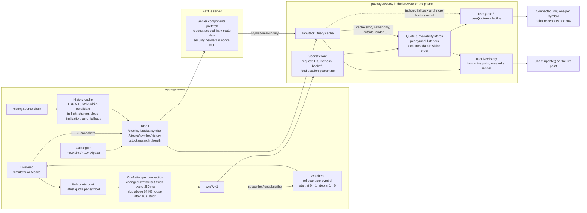
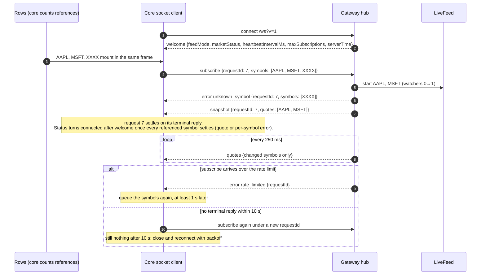

# Architecture and design reference

This document expands on the overview in [`README.md`](../README.md). Terms follow [`docs/glossary.md`](glossary.md), functional scope is in [`docs/spec.md`](spec.md), deployment steps live in [`docs/deploy.md`](deploy.md), and individual decisions live in [`docs/adr/`](adr/) (indexed in [`docs/adrs.md`](adrs.md)).

## Workspace boundaries

| Workspace | Responsibility |
| --- | --- |
| [`apps/gateway`](../apps/gateway) | Node and Fastify server exposing REST and one WebSocket. Pluggable per-mode adapters for `LiveFeed`, `HistorySource`, `Catalogue` and `MarketCalendar`. |
| [`apps/web`](../apps/web) | Next.js App Router app. Views take props only; connected components read core hooks and pass props to views. Owns web-specific presentation state (such as `apps/web/src/columns` per [ADR 0095](adr/0095-web-owns-table-column-choices.md)), Lightweight Charts in `integrations/`, and security headers/nonce-based CSP ([ADR 0094](adr/0094-web-security-headers-and-a-nonce-based-content-security-policy.md)). |
| [`apps/mobile`](../apps/mobile) | Expo Router app targeting Expo Go. Consumes the same `packages/core` hooks and `packages/tokens` with native views and platform adapters. |
| [`packages/contracts`](../packages/contracts) | Zod schemas for every WebSocket and REST payload, inferred TypeScript wire types, and the fixed-point BigInt money module. Sole source of wire types. |
| [`packages/core`](../packages/core) | Shared platform-agnostic client logic: WebSocket state machine, feed-session guard, keyed quote & availability stores, TanStack Query wrappers, hooks, formatters, i18n and analytics. Zero DOM, Next.js or React Native imports. |
| [`packages/tokens`](../packages/tokens) | Shared Graphite design values (light/dark palettes, spacing, typography, radii, motion). |

Architectural invariants enforced across workspaces:

- Wire types come exclusively from `packages/contracts`.
- Platform capabilities (`KeyValueStore`, `NetworkStatus`, `AppLifecycle`, `SocketFactory`, `HttpFetch`, `ColorSchemeStore`) enter `packages/core` only through `CoreProvider`.
- Shared financial, connection and query policy lives in `packages/core`; platform-specific presentation state (such as desktop table column choices in `apps/web/src/columns`) may live in its app without duplicating shared business logic ([ADR 0095](adr/0095-web-owns-table-column-choices.md)).
- Feed mode (`simulated` vs `live`) is chosen once at gateway startup via `FEED`, never mixed within a process, and guarded per client `CoreProvider` session ([ADR 0077](adr/0077-feed-changes-require-a-new-client-session.md)).
- `useEffect` is restricted by lint to `packages/core` and each app's `integrations/` directory.

## Gateway interface

Every quote, history and search REST response carries `feedMode` and `marketStatus` so server-rendered web pages paint accurate headers before the socket connects. Startup validates all gateway environment variables (`apps/gateway/src/config.ts`) and omits client IP addresses from request logs by default (`LOG_CLIENT_ADDRESSES=false`).

| Endpoint | Purpose |
| --- | --- |
| `WS /ws?v=1` | Live ticks, immediate snapshots, heartbeats, `market_status` updates, and simulator chaos controls scoped by `CHAOS_SCOPE` (`global` or `connection`, [ADR 0072](adr/0072-chaos-scope-keeps-shared-controls-off-public-gateways.md)); capped at 2,000 total sockets and 10 per IPv4 / IPv6 `/64` prefix ([ADR 0092](adr/0092-a-total-connection-cap-and-ipv6-budgets-by-prefix.md)) |
| `GET /stocks` (`?limit=&cursor=` or `?symbols=`) | Default 50 symbols, paginated catalogue slices with `nextCursor`, or explicit catalogue symbols for watchlists |
| `GET /stocks/:symbol` | Single stock name and quote (`404` outside active catalogue) |
| `GET /stocks/:symbol/history?range=` | Bars for `1D`, `1W`, `1M`, `3M`, `1Y` or `5Y`, plus `1D` session bounds, previous close and fallback `ageMs`; refreshed once after market close ([ADR 0082](adr/0082-finalize-history-after-market-close.md)) |
| `GET /stocks/search?q=` | In-memory catalogue search (at most 10 results, ranked exact match, symbol prefix, then word start in name) |
| `GET /stocks/:symbol/profile` | Company/fund overview, source and retrieval time; independent of quote availability |
| `GET /stocks/:symbol/statistics` | Key statistics in USD, source and retrieval time; independently cached (simulator omits price-dependent P/E and 52-week range, [ADR 0080](adr/0080-omit-unsupported-simulated-year-range.md)) |
| `GET /stocks/:symbol/news` | Up to nine recent stories, source and retrieval time; cached for ten minutes |
| `GET /stocks/:symbol/earnings` | Upcoming report dates and up to four fiscal EPS comparisons; independently cached |
| `GET /health` | Active socket connections, upstream watched symbols, history cache hit rate, and built commit `revision` when supplied at image build time ([ADR 0075](adr/0075-gateway-closes-on-signals-and-reports-its-revision.md)) |

## Data flow

- **Live path:** One upstream feed serves every client connection on the gateway process. The hub holds the latest quote per symbol, and each connection tracks changed symbol names and flushes periodic `quotes` batches every 250 ms (skipping slow sockets above 64 KB buffered and closing sockets stuck for 10 s). Per-connection control work is bounded (256 pending operations, 300 over-limit messages per 10 s, 30 s per-address cooldown on close `1008`, [ADR 0076](adr/0076-bound-socket-control-work-and-close-abusive-connections.md)). In `packages/core`, local per-symbol quote revisions prevent delayed REST responses from clearing newer `lastKnown` metadata, semantically identical quotes skip redundant notifications, and `useQuoteAvailability(symbol)` / `useQuoteWarning(quote)` expose per-symbol degradation independently of transport status ([ADR 0083](adr/0083-order-quote-metadata-and-track-symbol-availability.md)). Any conflicting feed mode on reconnect, REST or hydration permanently quarantines that `CoreProvider` instance until reload/restart ([ADR 0077](adr/0077-feed-changes-require-a-new-client-session.md)).
- **History path:** One caching pipeline wraps every `HistorySource`, simulator included. It coalesces concurrent identical requests, serves stale entries while refreshing, discards cross-phase responses and refreshes open-phase entries once after market close ([ADR 0082](adr/0082-finalize-history-after-market-close.md)), and returns expired copies tagged with `ageMs` ("As of") if every source fails. In Alpaca mode, history draws from a 60 req/min sub-cap inside the shared 180 req/min data budget ([ADR 0093](adr/0093-history-gets-a-share-of-the-alpaca-budget.md)).
- **First frame, hydration fallback and web security:** Next.js Server Components share one request-scoped default-list read across shell metadata and home hydration, reducing a home render from three gateway reads to two, and stock/search links prefetch only on navigation ([ADR 0078](adr/0078-share-initial-server-catalogue-reads.md)). Until the quote store holds a symbol, `useQuote` reads a lazily maintained `WeakMap<QueryCache, QuoteIndex>` fallback ([ADR 0068](adr/0068-index-the-hydration-quote-fallback.md)) without writing to the quote store during render. Every web response sets security headers (`nosniff`, `DENY`, `Referrer-Policy`, `Permissions-Policy`, no `X-Powered-By`) and a per-request nonce-based Content Security Policy ([ADR 0094](adr/0094-web-security-headers-and-a-nonce-based-content-security-policy.md)).

## Subscribe and reply protocol

Unless the gateway closes the socket first—on an internal subscribe error (code `1011`), an outbound buffer stalled for 10 seconds under [ADR 0008](adr/0008-per-connection-conflation-in-the-gateway.md), or overload/abuse closure under [ADR 0076](adr/0076-bound-socket-control-work-and-close-abusive-connections.md)—every parsed `subscribe` receives exactly one terminal reply (a `snapshot` or a correlated `rate_limited` error), and each requested symbol is accounted for once, either in the snapshot or in an `unknown_symbol`, `subscription_limit`, or `unavailable` error bearing the same `requestId`. The client enters `connected` after receiving `welcome` and settling every referenced symbol (which can include per-symbol errors); `unavailable` indicates the gateway kept the subscription and will deliver the first quote as a tick ([ADR 0038](adr/0038-subscribe-replies-carry-a-request-id.md)).

Valid `unsubscribe` frames below connection overload limits are always applied even when the 20-message rolling one-second budget is exhausted, preventing leaked server subscriptions after network-stall bursts ([ADR 0066](adr/0066-always-apply-valid-unsubscribes.md), [ADR 0076](adr/0076-bound-socket-control-work-and-close-abusive-connections.md)).

## Supplemental stock page data

Four independent endpoints supply optional context on the stock detail screen without blocking live prices or charts. Empty responses hide their section cleanly; failed requests retain independent retry actions.

- **Company overview (`GET /stocks/:symbol/profile`):** In Live mode, the gateway fetches Yahoo descriptions, sector, industry, exchange and website via `yahoo-finance2` with a 24-hour cache (5-minute empty cache) and an 8-second upstream timeout. Simulator mode makes no external requests and returns labelled fictional samples for `AAPL`, `MSFT`, `SPY`, `QQQ` and `VTI` (other symbols return unavailable). Yahoo is an unofficial temporary demo source behind a replaceable adapter boundary ([ADR 0055](adr/0055-yahoo-company-overviews-stay-separate-from-prices.md), [source research](research/stock-page-data-sources.md)).
- **Key statistics (`GET /stocks/:symbol/statistics`):** Returns market cap, trailing P/E and EPS, indicated dividend yield, 3-month average daily volume and 52-week range in USD (Live: Yahoo with 1-hour cache, 5-minute empty cache, and 8-second deadline; simulator: labelled samples). Funds omit equity valuation fields; missing fields render `—`. The 52-week range marker compares against the latest gateway price **only when a 52-week range is supplied**, so prices and statistics may refresh on different cadences ([ADR 0056](adr/0056-key-statistics-are-independent-supplemental-data.md)). In simulator mode, price-dependent `trailingPE` and `yearRange` are omitted (`null`, shown as `—`) rather than returning fixed sample values that contradict the deterministic simulated price; live provider statistics are unchanged ([ADR 0080](adr/0080-omit-unsupported-simulated-year-range.md)).
- **Company news (`GET /stocks/:symbol/news`):** In Live mode, the gateway fetches and parses Yahoo ticker RSS, validates links, deduplicates items and returns up to nine headlines reverse-chronologically (10-minute cache, 8-second deadline). Clients show three headlines with Show more/Show less expansion. Missing publishers fall back to hostname and missing or failed thumbnails fall back to text rows. Articles open externally; simulator stories are labelled fictional with no outbound links ([ADR 0057](adr/0057-stock-news-comes-through-the-gateway.md)).
- **Earnings (`GET /stocks/:symbol/earnings`):** Displays upcoming report dates (preserving confirmation status), last reported EPS and up to four chronological fiscal quarters comparing actual vs estimated EPS (1-hour cache, 5-minute empty cache). Accounting basis is preserved, only explicitly USD EPS is shown, and ETFs omit the section ([ADR 0058](adr/0058-earnings-and-hidden-empty-sections.md)).

## Decisions and trade-offs reference

Summary of core architectural decisions across the codebase; see [`docs/adrs.md`](adrs.md) for the complete index of all 89 ADRs (`0001`–`0098`).

| Decision | Rationale and trade-off | ADR |
| --- | --- | --- |
| Single reference-counted gateway with admission & work bounds | Provider usage tracks distinct watched symbols and keys stay server-side; caps total sockets at 2,000, keys limits/cooldowns by IPv4 or IPv6 `/64`, bounds pending socket ops (256) and abusive bursts (300/10 s → close `1008` + 30 s cooldown), and drains cleanly on `SIGTERM` (close `1001`) with `/health` `revision`. | [0006](adr/0006-subscription-semantics-and-reference-counting.md), [0028](adr/0028-fastify-gateway-with-explicit-limits.md), [0075](adr/0075-gateway-closes-on-signals-and-reports-its-revision.md), [0076](adr/0076-bound-socket-control-work-and-close-abusive-connections.md), [0092](adr/0092-a-total-connection-cap-and-ipv6-budgets-by-prefix.md) |
| Two-stage digest-pinned gateway image | Production dependencies only, stripping package managers and `tsx`; runs `main.ts` directly via Node 26 native type stripping (454 MB vs 745 MB, zero high/critical Node package findings). | [0091](adr/0091-the-gateway-image-holds-only-what-runs.md) |
| Per-connection conflation and backpressure | Prices are state, not an event log. Periodic `quotes` batches flush every 250 ms, skip sockets above 64 KB buffered, and close sockets stuck for 10 s. | [0008](adr/0008-per-connection-conflation-in-the-gateway.md) |
| Visibility-driven subscriptions | Virtualised lists subscribe only to mounted rows, keeping upstream demand proportional to visible symbols. | [0007](adr/0007-virtualised-list-with-visibility-driven-subscriptions.md) |
| Deterministic BigInt simulator & pluggable calendar | Price is a pure function of seed, symbol and time so history bars and live ticks agree by construction; simulated statistics omit price-dependent P/E and 52-week range rather than contradicting live simulated quotes. | [0022](adr/0022-deterministic-simulator-with-pluggable-market-calendar.md), [0080](adr/0080-omit-unsupported-simulated-year-range.md) |
| Explicit, unmixed feed mode & session quarantine | One `FEED` switch selects all four gateway adapters; any conflicting mode across reconnect, REST or SSR hydration permanently quarantines that `CoreProvider` instance until reload/restart. | [0003](adr/0003-split-live-feed-and-history-source.md), [0004](adr/0004-explicit-feed-mode-and-gateway-owned-market-status.md), [0077](adr/0077-feed-changes-require-a-new-client-session.md) |
| Pre-rounded decimal strings and BigInt money maths | Avoids IEEE-754 float drift (especially Hermes formatting on mobile); displayed change always equals displayed price minus previous close. | [0015](adr/0015-server-owns-money-maths-wire-carries-rounded-decimal-strings.md), [0037](adr/0037-rounding-display-precision-and-baseline-policy.md) |
| Correlated subscribe request IDs & always-applied unsubscribes | Eliminates arrival-order races under rate limits and slow upstreams; valid unsubscribes below overload bounds always apply. | [0038](adr/0038-subscribe-replies-carry-a-request-id.md), [0066](adr/0066-always-apply-valid-unsubscribes.md) |
| Keyed quote store, metadata ordering & per-symbol availability | Structural single-row re-renders for ticks, local revision precedence protecting `lastKnown` from delayed REST responses, identical-quote suppression, and independent `useQuoteAvailability` / `useQuoteWarning` hooks. | [0012](adr/0012-tanstack-query-for-requests-keyed-store-for-quotes.md), [0083](adr/0083-order-quote-metadata-and-track-symbol-availability.md) |
| Server-rendered first frame, read deduplication & web CSP | Request-scoped SSR catalogue read (2 gateway reads per home load, no speculative row prefetch), indexed `WeakMap` hydration fallback, and per-request nonce-based CSP + security headers. | [0023](adr/0023-server-renders-first-frame-socket-takes-over-after-hydration.md), [0068](adr/0068-index-the-hydration-quote-fallback.md), [0078](adr/0078-share-initial-server-catalogue-reads.md), [0094](adr/0094-web-security-headers-and-a-nonce-based-content-security-policy.md) |
| Shared core vs app-owned presentation state | Financial, connection and query policy lives in `packages/core` (pinned by `index.test.ts`); web-only desktop table column preferences live in `apps/web/src/columns`. | [0002](adr/0002-logic-free-components-and-platform-agnostic-core.md), [0041](adr/0041-the-frozen-core-api.md), [0095](adr/0095-web-owns-table-column-choices.md) |
| No replay; newest wins, two-way liveness & closed-market history finalization | Reconnects re-snapshot visible symbols and refetch charts; 5 s heartbeats detect silent disconnects; open-phase history refreshes once after market close and discards cross-phase fetches. | [0009](adr/0009-no-replay-source-timestamps-and-resnapshot-on-reconnect.md), [0010](adr/0010-two-way-liveness-checks-and-typed-errors.md), [0082](adr/0082-finalize-history-after-market-close.md) |
| Day-one RTL, i18n, accessibility & Graphite tokens | Logical CSS checked by `pnpm check:direction`, LTR isolation for prices/charts, live Arabic switch, native range buttons with 3×2 narrow layout, accessible row metric labels, and reduced-motion support. | [0016](adr/0016-day-one-conventions-rtl-i18n-analytics-platform-interfaces.md), [0051](adr/0051-arabic-with-an-in-place-language-switch.md), [0079](adr/0079-chart-range-button-semantics.md) |
| In-memory catalogue search & resilient on-device watchlist | Zero upstream API cost per keystroke; versioned `watchlist:v1` storage recovers from corrupt values, rolls back and announces failed saves, syncs across web tabs, and resolves extra symbols in core. | [0013](adr/0013-symbol-catalogue-as-a-pluggable-source-for-search.md), [0014](adr/0014-watchlist-as-symbols-behind-a-storage-interface.md), [0065](adr/0065-watchlist-stocks-resolve-in-core.md) |
| Scoped simulator chaos controls & debug diagnostics | `CHAOS_SCOPE=global` locally (with 60 s auto-revert) vs `CHAOS_SCOPE=connection` on public gateways (shared controls refused and hidden in both apps); debug panel and mobile sheet surface connection counters plus read-only client-side subscription and symbol-recovery diagnostics (`ConnectionHealth.diagnostics`, no public server endpoint or raw provider errors). | [0030](adr/0030-chaos-controls-in-simulator-mode.md), [0036](adr/0036-connection-health-metrics-in-the-debug-panel.md), [0040](adr/0040-broadcast-chaos-state-with-revert-timestamps.md), [0071](adr/0071-mobile-chaos-controls-behind-a-settings-switch.md), [0072](adr/0072-chaos-scope-keeps-shared-controls-off-public-gateways.md), [0081](adr/0081-separate-readiness-from-symbol-diagnostics.md) |
| Alpaca 30-symbol stream, shared 180/60 budget & phase enforcement | Streams 30 most-watched symbols and batch-polls the rest every 5 s under one 180 req/min budget (60/min sub-cap for history); hub enforces trading phase and failure-gated `lastKnown` marks. | [0021](adr/0021-alpaca-adapter-streams-30-and-polls-the-rest.md), [0044](adr/0044-hub-enforces-quote-phase-from-timestamps.md), [0045](adr/0045-last-known-quotes-after-failed-phase-refresh.md), [0046](adr/0046-last-known-requires-a-failed-request.md), [0093](adr/0093-history-gets-a-share-of-the-alpaca-budget.md) |
| Canvas web chart / Expo Go SVG chart | Lightweight Charts updates the live point outside React; Expo Go avoids native builds via `react-native-wagmi-charts` with path transitions off and index-based lookup. | [0026](adr/0026-lightweight-charts-for-the-web-chart.md), [0033](adr/0033-expo-go-constraint-and-react-native-graph.md), [0034](adr/0034-mobile-lifecycle-navigation-and-adapters.md) |
| Tool-enforced code rules & three-seam testing | Custom OxLint no-comments rule, size limits, `useEffect` fence (`pnpm lint:fixtures`), and critical-path tests at gateway, core and production E2E seams. | [0017](adr/0017-critical-path-unit-and-end-to-end-tests.md), [0018](adr/0018-code-rules-enforced-by-tooling.md) |
