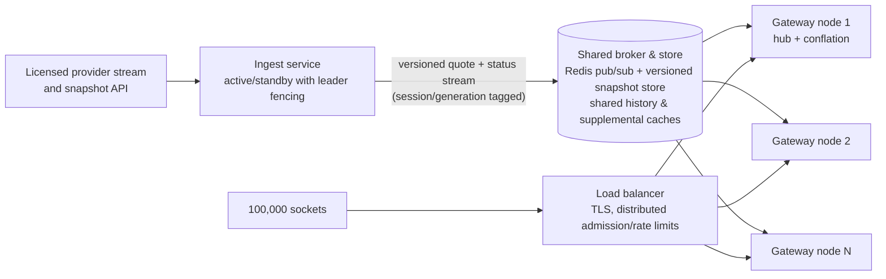

# Scaling to 100,000 concurrent users

This document separates **what is implemented today**, **what has been measured locally**, and **what is an unmeasured distributed-scaling proposal**. None of the multi-node infrastructure below is built in this project; the goal is to state the real limits and engineering prerequisites accurately.

## What is implemented today

A single gateway process owns process-local subscriptions, latest quotes, market-calendar state, history cache and supplemental caches:

- **Reference-counted subscriptions:** Upstream subscriptions are shared among connections on that process ([ADR 0006](adr/0006-subscription-semantics-and-reference-counting.md)).
- **Bounded periodic conflation:** Each connection tracks changed symbol names and flushes periodic `quotes` batches every 250 ms, capping periodic quote batches at 4/s (**not every frame**: `welcome`, `snapshot`, `heartbeat`, `market_status`, `chaos_state` and error frames are also sent). Slow sockets above 64 KB buffered are skipped and closed after 10 s stuck ([ADR 0008](adr/0008-per-connection-conflation-in-the-gateway.md)).
- **Admission and control-work limits:** The current gateway admission ceiling is **2,000 total sockets per process** (`503` above cap, `fly.toml` soft 2,000 / hard 2,500) with **10 sockets per IPv4 address or IPv6 `/64` prefix** ([ADR 0092](adr/0092-a-total-connection-cap-and-ipv6-budgets-by-prefix.md)), plus 256 pending operations/connection, 300 over-limit messages per 10 s (close `1008`), and a 30 s per-address cooldown ([ADR 0076](adr/0076-bound-socket-control-work-and-close-abusive-connections.md)).
- **Stateless client reconnects:** Clients keep no server affinity, resubscribe in one message on reconnect ([ADR 0009](adr/0009-no-replay-source-timestamps-and-resnapshot-on-reconnect.md)), and use full-jitter backoff (0.5 s to 30 s) to spread reconnect waves ([ADR 0010](adr/0010-two-way-liveness-checks-and-typed-errors.md)).

At today's configured **2,000-socket** ceiling, 100,000 concurrent sockets would require at least **50 gateway nodes** before failover headroom—that is simple arithmetic, not proof that 50 nodes suffice, and raising the constant alone does not establish safe single-node capacity.

## Measurements vs projections

- **Local simulator loopback load test (`a4a1b7a`):** Short local run (10, 100, 500 and 1,000 concurrent sockets, 50 shared symbols per socket, gateway logger disabled, 10 sockets per distinct `127/8` loopback IP, **17.03 s** total at 1,000 sockets including ramp-up) delivered all snapshots with zero recorded connection errors, ~3,755 frames/s, 256 ms p99 quote age, and returned active connections and watchers to 0 after teardown. Full workload conditions and caveats live in [`docs/verification.md#local-load-test-workload`](verification.md#local-load-test-workload).
- **Single-core container admission check ([ADR 0092](adr/0092-a-total-connection-cap-and-ipv6-budgets-by-prefix.md)):** Local simulator run in a 1-core, 512 MB container with every socket subscribed to the 50 default symbols measured 170 MB RSS and 43–61% of one laptop core at 2,000 sockets (206 MB at 3,000 sockets) at ~4.1 frames/socket/s. A shared cloud vCPU is slower and distinct live-mode symbols cost more per socket; 2,000 is an admission guardrail, not proof of production capacity.
- **Client cache microbenchmark ([`docs/performance/quote-cache-index.md`](performance/quote-cache-index.md)):** Controlled Node A/B microbenchmark on the client's cold-cache hydration fallback (10,000 cached stocks, 50-row snapshot batch: 25.25 ms → 1.91 ms median; 7-round ranges, not p99 latencies). This is a client helper microbenchmark, not a gateway load test or full-page/mobile benchmark.
- **Projected 100,000-user topology:** Everything below is an **unmeasured architectural design**; neither sustained production load nor 100,000 concurrent users has been tested.

## Target multi-node topology (proposed, unbuilt)

| Today (one process) | Multi-node proposal (unbuilt) |
| --- | --- |
| The hub owns the provider connection | An **ingest service** holds the single upstream provider connection (active/standby gated by a fenced leader lease so old leaders cannot publish stale updates) and publishes versioned quotes and `market_status` transitions. Gateway nodes subscribe through a distributed adapter; while `LiveFeed` and `MarketCalendar` are useful seams, keeping every internal hub/interface detail unchanged is **unproven**—a coordinated adapter may require an internal readiness/generation contract rather than a configuration-only swap. |
| Reference counts per process | Each gateway node counts its own watchers and subscribes to symbol channels on 0 → 1, so broker fan-out scales with ticks × nodes rather than ticks × users. |
| In-memory snapshots & calendar | **Coherent, versioned snapshots** sharing an ingestion generation and session/version with quotes and `market_status` (see Redis recovery prerequisites below). |
| In-memory history & supplemental caches | Shared cluster caches with **bounded distinct-key admission** and **provider-wide request budgets**, preserving endpoint TTLs, closed-market finalization and "as of" fallback rules. |
| Per-process IPv4/IPv6 `/64` rate & socket limits | Distributed admission, abuse cooldowns and per-IP/prefix limits enforced at the edge or in shared state so limits do not multiply by replica count. |
| `GET /stocks` per page load | Short (~1 s) CDN cache on the default list; WebSocket re-snapshots remain safe under newest-timestamp-wins and local metadata ordering. |
| Planned SQLite watchlist ([ADR 0031](adr/0031-server-side-watchlist-keyed-by-device-id.md), unbuilt) | Postgres keyed by authenticated user once accounts exist. |

## Distinct symbols, provider budgets and cold-key limits

User count alone does not determine upstream demand; **distinct watched symbols** and **distinct uncached REST keys** do:

- **Watched-symbol polling math (`FEED=alpaca`):** Let `D` be distinct actively watched symbols on one feed instance, `S` the streamed subset (`S ≤ 30` on Alpaca free tier), and `P = D − S`. In an open session, stable full 100-symbol batches polled every 5 s cost roughly **`12 × ceil(P / 100)` snapshot requests/minute** (e.g., `D = 1,030` → `120/min`; `D = 1,530` → `180/min` before history, missing-baseline lookups, initial REST reads, churn, retries or session transitions).
- **Shared 180/60 Alpaca budget ([ADR 0093](adr/0093-history-gets-a-share-of-the-alpaca-budget.md)):** The Alpaca adapter caps total data requests at **180/min per adapter instance**, **including a 60/min sub-cap for history** (history is not an extra 60; live requests can consume all 180, shared backoff pauses all data calls on provider failure, and pagination consumes starts). Replicating today's adapter without centralized budgeting multiplies upstream demand across nodes. Broad-universe traffic at 100,000 users requires a licensed full-market feed and account-wide budgeting.
- **Cold history keys:** The 500-entry LRU history cache and same-key in-flight coalescing (or Redis locks per key) deduplicate repeated requests for the **same** `(symbol, range)` key; they do **not** bound demand across many **distinct** cold keys, and Alpaca budget rejections surface as fallback "as of" or `503`.
- **Supplemental Yahoo routes (outside Alpaca's budget):** `profile`, `statistics`, `news` and `earnings` each keep a separate 500-entry cache and admit up to **8 concurrent distinct loads per route** (up to 32 concurrent route loads per process, with different TTLs: 24 h profiles, 1 h statistics/earnings, 10 min news, plus 5 min empty caches for profile/statistics/earnings; earnings may make two quote-summary calls). Concurrency limits are not requests/minute limits, and caches/loads multiply with replicas—requiring provider-wide admission and shared caching before scaling live mode.

## Redis recovery and coherent snapshots

Redis Pub/Sub provides **at-most-once** delivery: a disconnected subscriber misses published messages with no replay ([Redis delivery semantics](https://redis.io/docs/latest/develop/pubsub/#delivery-semantics)). A healthy client WebSocket does not imply a healthy gateway-to-Redis subscription. Any distributed design must address:

- **Outage detection & resynchronization:** Gateway nodes must detect Redis or ingest disconnects, stop advertising fresh data, and resynchronize upon reconnect.
- **Coherent generation/session snapshots:** Reading an unversioned latest-quote hash independently of a `market_status` key can mix stale quotes with a newer phase or lose updates between subscribe and snapshot read. Recovery needs a shared ingestion generation/session tag, subscribe-and-buffer before reading a coherent versioned snapshot, leader fencing for ingest failover, and explicit invalidation when generation or session changes.

## Bottlenecks and prerequisites before claiming 100,000 users

1. **Conditional payload egress & serialization:** Under the illustrative envelope of 15 visible rows changing every 250 ms flush at ~150 bytes/quote (`15 × 150 B × 4/s × 100,000`), raw quote payload egress is **900 MB/s (7.2 Gbit/s)**—excluding WebSocket/TCP framing, TLS, heartbeats, snapshots and retransmissions, and assuming 150 B/quote (which varies with `dayRange` and metadata) with every row changing every flush. Pre-serializing quotes once per flush and enabling or disabling per-message compression are optimization candidates to measure on real payloads, not established savings or losses.
2. **Per-node socket ceiling & flush loop:** Today's gateway enforces a 2,000-socket admission cap; scaling node density requires profiling the 250 ms flush loop, event-loop lag, GC/heap and NIC saturation under realistic symbol overlap and slow consumers.
3. **Reconnect storms:** Node loss or deploys trigger jittered reconnects (0.5–30 s) demanding immediate snapshots; coherent shared snapshots absorb failover without hitting upstream providers.
4. **Provider entitlements & multi-route budgets:** Broad-universe watching and cold history/supplemental traffic require licensed upstream capacity and account-wide rate/admission controls.

**Verification prerequisites before claiming 100,000 concurrent users:** define an explicit workload (symbol overlap, history/supplemental mix, navigation churn, payload sizes, slow-client fraction); verify provider entitlements and centralized budgets; implement coherent ingest failover and Redis resynchronization; run multi-node load tests measuring CPU, heap, event-loop p99, network and broker saturation across node loss, Redis disconnects, cold-cache bursts, reconnect storms and rolling deploys with N+1 headroom.
