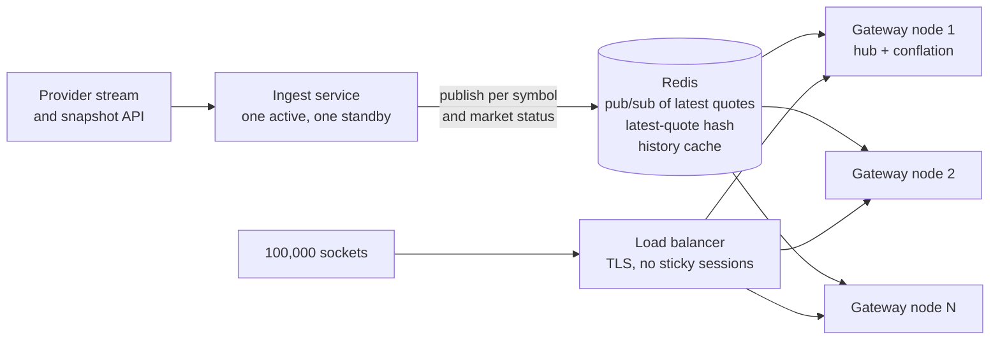

# Scaling to 100,000 concurrent users

## Measured vs projected

Separate what has been measured from what is an analytical projection:

- **Measured (local single-node simulator):** An independent verification run on audited revision `07a9bf3` exercised the local simulator gateway over loopback at 10, 100, 500 and 1,000 concurrent WebSocket connections (50 shared symbols per connection, gateway logger disabled, 10 connections per distinct `127/8` loopback address, **17.03 s** total at 1,000 connections including ramp-up). At 1,000 connections, all snapshots arrived with zero recorded connection errors, roughly 3,755 frames/s, 256 ms p99 quote age, and active connection and upstream watcher counts returned to 0 after teardown. A controlled microbenchmark also measured the cold-cache quote fallback index (`docs/performance/quote-cache-index.md`). Full workload conditions and caveats—short local run, shared dev host, loopback without TLS, quote age vs pure network latency—are recorded in [`docs/verification.md`](verification.md#local-load-test-workload).
- **Projected (unmeasured multi-node design):** Everything below for **100,000 concurrent users** is an analytical architecture and capacity estimate derived from constants in the code. It has **not** been load-tested and is **not** proof of sustained production or 100,000-user capacity.

## What already scales in the current design

- **Reference-counted upstream subscriptions:** Provider demand tracks distinct watched symbols rather than connected users ([ADR 0006](adr/0006-subscription-semantics-and-reference-counting.md)).
- **Bounded per-connection conflation:** Each connection holds only changed symbol names and flushes at most 4 frames/s, skipping slow sockets above 64 KB buffered and closing sockets stuck for 10 s ([ADR 0008](adr/0008-per-connection-conflation-in-the-gateway.md)).
- **Stateless reconnects:** Clients keep no server affinity; after any disconnect they resubscribe in one message and take fresh snapshots ([ADR 0009](adr/0009-no-replay-source-timestamps-and-resnapshot-on-reconnect.md)) with full-jitter backoff (0.5 s to 30 s) so clients do not reconnect in lockstep ([ADR 0010](adr/0010-two-way-liveness-checks-and-typed-errors.md)).

## Target architecture at 100,000 connections

| Today (one process) | At scale (multi-node) |
| --- | --- |
| The hub owns the provider connection | An **ingest service** holds the single upstream provider connection (active/standby gated by a short Redis leader lease so only one instance connects upstream) and publishes each quote and `market_status` transition to Redis. Gateway nodes consume Redis through a new `LiveFeed` adapter, leaving hub, conflation and socket code intact ([ADR 0011](adr/0011-one-pipeline-for-every-data-source-with-history-cache.md)). |
| Reference counts per process | Each gateway node counts its own watchers and subscribes to a Redis channel on 0 → 1, as today. Redis fan-out scales with ticks × nodes rather than ticks × users. On a paid full-market feed, ingest can stream the whole catalogue without cross-node upstream ref-counting. |
| Snapshots from hub memory | Snapshots read a **latest-quote hash** in Redis (plus the current `market_status` key) so newly started nodes or nodes absorbing failover reconnects answer immediately. |
| In-memory history cache | **Redis with the same keys** (`symbol`, `range`) so one upstream fetch serves the whole cluster. In-flight deduplication becomes per-node singleflight plus a short Redis lock with wait/notify per key. |
| Rate limits per IP, per process | Enforce per-IP limits at the load balancer or in Redis so effective limits do not multiply by node count. |
| `GET /stocks` per page load | Place a ~1-second CDN cache on the default list. The WebSocket re-snapshots on connect, so slightly older REST quotes remain safe under newest-timestamp-wins. |
| Planned SQLite watchlist ([ADR 0031](adr/0031-server-side-watchlist-keyed-by-device-id.md), unbuilt) | Postgres keyed by authenticated user once accounts exist. |

## Bottlenecks in the order they bite

1. **Egress and serialisation:** With ~15 visible rows changing every 250 ms flush (`15 × ~150 B × 4 frames/s`), per-connection egress is roughly 9 KB/s, or ~900 MB/s (~7 Gbit/s) across 100,000 connections. Pre-serialising each quote once per flush and assembling frames from shared buffers removes per-connection JSON serialisation CPU, leaving frame assembly and socket writes. Per-message WebSocket compression often costs more CPU than it saves on small quote frames and should be measured before enabling.
2. **Sockets per node:** At an illustrative ~10,000 connections per gateway node, serving 100,000 connections requires roughly 10 nodes plus failover headroom. The 250 ms flush loop iterates across connections on each node and is the first hot path to profile under sustained load.
3. **Reconnect storms:** When a gateway node restarts, ~10,000 clients reconnect across the 0.5 s to 30 s jitter window and request snapshots. Serving snapshots from Redis's latest-quote hash absorbs failover without hitting upstream providers.
4. **Upstream provider cap:** Alpaca's free tier streams 30 symbols and the polling fallback costs roughly 12 calls/min per 100 polled symbols ([ADR 0021](adr/0021-alpaca-adapter-streams-30-and-polls-the-rest.md)). At 100,000 users, watched symbols approach the whole catalogue, requiring a paid full-market feed. The `LiveFeed` adapter boundary keeps that an adapter and configuration change rather than a client rewrite.
5. **Cold history misses:** Uncommon symbol/range misses remain the main path where user traffic turns into provider calls; a cluster-wide Redis cache plus stale-while-revalidate and "as of" fallback keep upstream demand bounded.

> **Reconciliation note:** Scaling assumptions and single-node gateway constants are scheduled for further technical reconciliation once pending architecture and reliability PRs are merged and verified.
